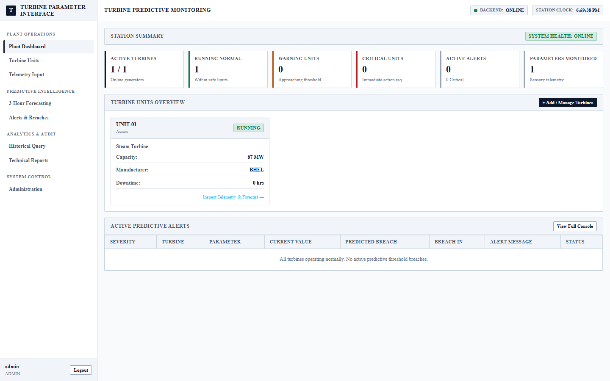
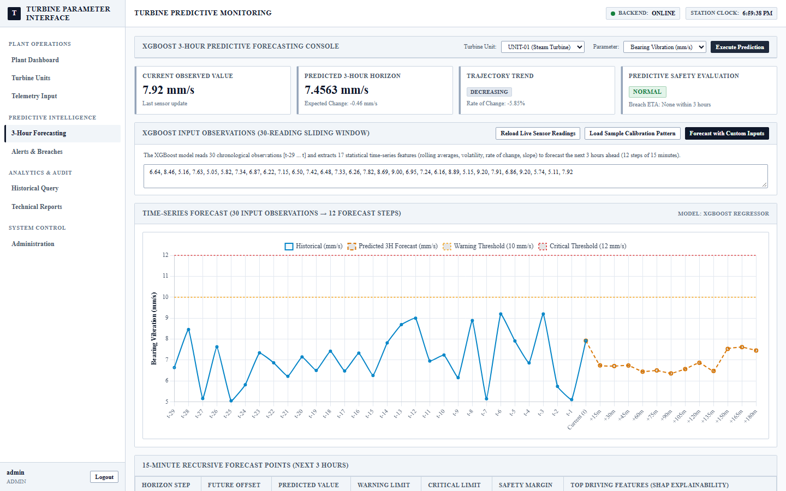
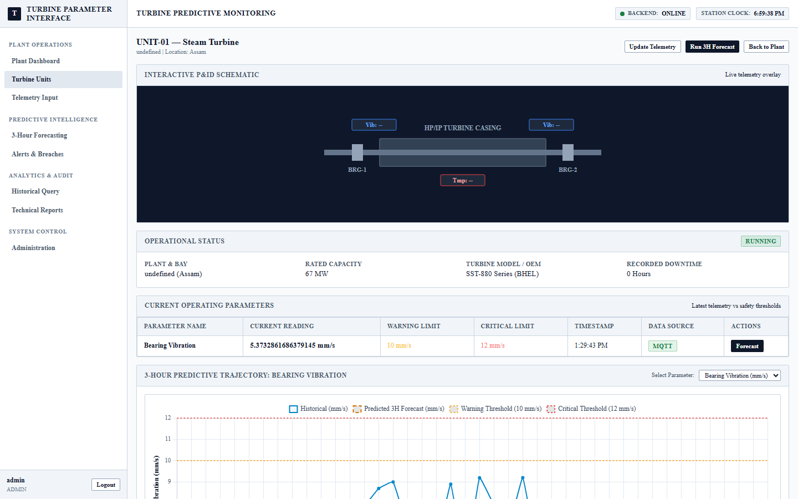
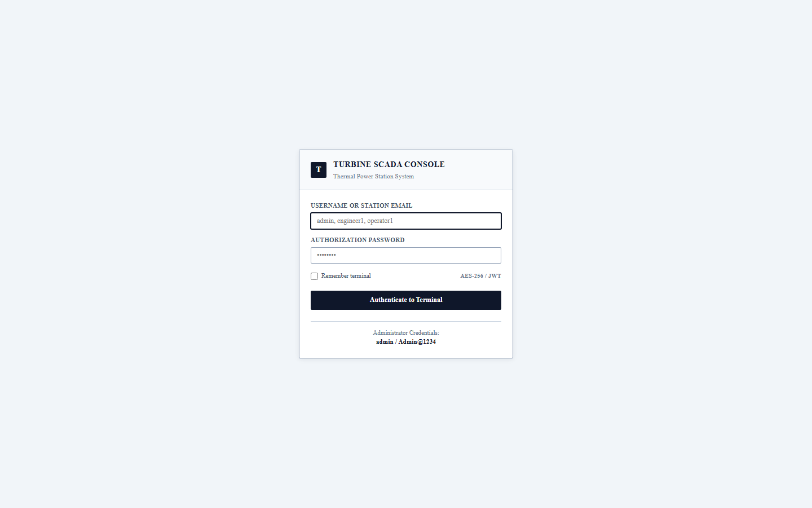

# Turbine Predictive Monitoring & SCADA Alert Platform

[](LICENSE)


An industrial SCADA and predictive analytics platform engineered for thermal power plant turbines. Integrates real-time sensory telemetry streaming, recursive **XGBoost** time-series forecasting (3-hour horizon), **SHAP** feature attribution, automated threshold alerting, and interactive P&ID turbine schematics.



---

## Key Features

- **3-Hour Recursive Forecasting**: Reads sliding 30-reading observation windows, extracts 17 statistical time-series features (rolling averages, volatility, rate of change, slope), and recursively predicts 12 steps (15-min intervals) ahead using `XGBRegressor`.
- **Explainable AI (SHAP)**: Identifies the top driving sensor features impacting each predicted step.



- **Interactive P&ID Schematic**: Live SVG turbine schematic with real-time WebSocket telemetry overlays.



- **Automated Threshold Safety & CMMS Dispatch**: Detects warning and critical threshold breaches in advance and dispatches simulated maintenance work orders to SAP PM / CMMS.
- **Role-Based Access Control (RBAC)**: JWT-authenticated roles for Administrators, Engineers, and Control Room Operators with audit logging.

---

## Tech Stack

- **Backend**: Python, Flask, Flask-SocketIO, SQLAlchemy, Celery, Redis
- **Machine Learning**: XGBoost, Scikit-learn (Isolation Forest), SHAP, Joblib, NumPy, Pandas
- **Frontend**: Vanilla JavaScript (ES6+), Industrial SCADA CSS, Chart.js
- **DevOps**: Docker, Docker Compose, Pytest

---

## Getting Started

### 1. Backend Setup

```bash
cd backend

# Create virtual environment
python -m venv .venv
source .venv/bin/activate  # On Windows: .\.venv\Scripts\activate

# Install dependencies
pip install -r requirements.txt

# Seed database with initial turbine units and accounts
python seed.py

# Start backend server (http://127.0.0.1:5000)
python run.py
```

### 2. Frontend Setup

In a separate terminal:

```bash
cd frontend
python -m http.server 3001
```

Open `http://localhost:3001/login.html` in your browser.

---

## Default Login Credentials



| Role | Username | Password | Access Scope |
| :--- | :--- | :--- | :--- |
| **Administrator** | `admin` | `Admin@1234` | Full system control, unit provisioning & user management |
| **Engineer** | `engineer1` | `Engineer@1234` | 3H forecast execution, model management & data imports |
| **Operator** | `operator1` | `Operator@1234` | Live telemetry monitoring, gauge inputs & alert triage |

---

## Automated Tests

Run backend unit and integration tests:

```bash
cd backend
python -m pytest
```

---

## License

This project is licensed under the MIT License - see the [LICENSE](LICENSE) file for details.
